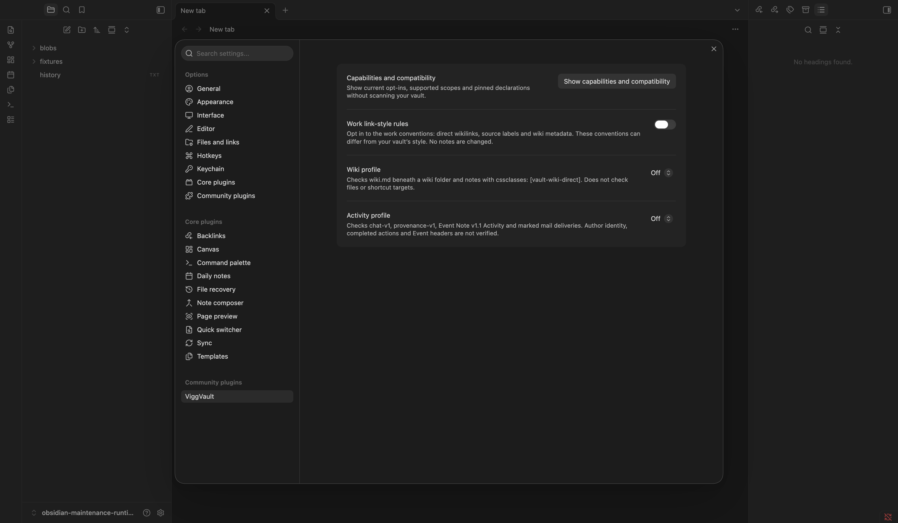
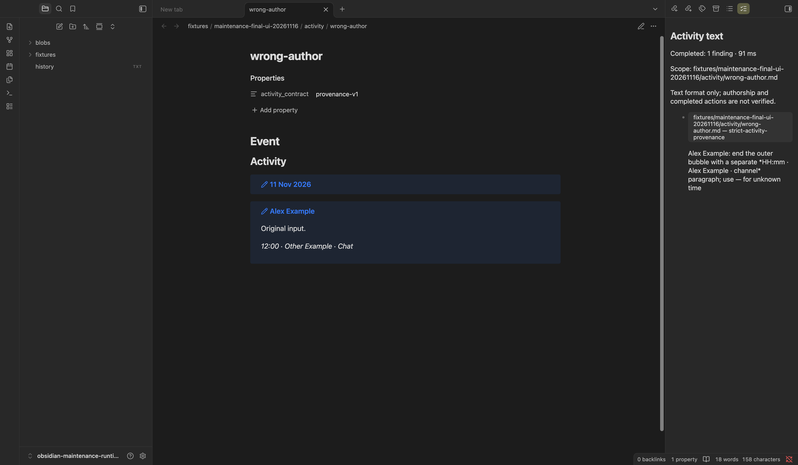
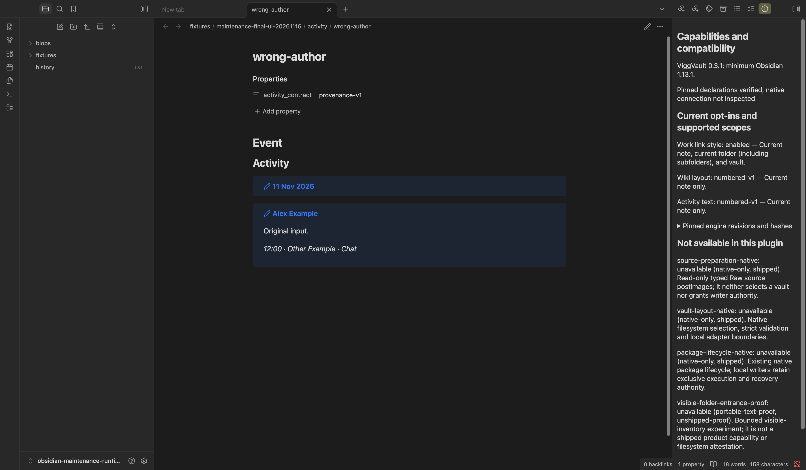

# Obsidian 1.15.1 maintenance candidate — 16 November 2026

Private local staging of patch0.3.1 from public source `a0cf826cbb7835f444ef8b8011e29934ea47cfb8`. The version metadata, capabilities-panel expected version and official lint dependency0.6.0 change. The Activity npm/Cargo build boundary now uses a verified sibling workspace and a new reproducible WASM asset. TypeScript runtime and all vendored upstream Rust source remain unchanged; Work/Wiki asset pins remain unchanged.

Ordinary npm ci, official lint, TypeScript, production build/privacy checks and the full44-test suite passed with the new asset. This includes the existing semantic native/WASM parity tests and six build-workspace/lock guards. Earlier baseline/version-only runs passed38/38 under a15second per-test deadline; an earlier independent activity-snapshot-check stall did not reproduce. Its original cause is not established by these later passes. Production npm audit reports0vulnerabilities.

The former Activity asset `40905f151c27fe21d9ddb83ac6698b69be0ae9723a2c7b30faf4e31fa09b4183` did not reproduce at two checkout paths. It is preserved in maintenance evidence as a historical failed gate, not declared reproducible. The repaired build compiles unchanged provenance-pinned upstream sources in one verified sibling workspace. Two separate checkouts produce new SHA-256 `c4bb2684e924e178297fe14df73c39a940e34be1755e080a9d8299c19441c512`, now the explicitly reviewed Activity asset/provenance pin. The unweakened check:wasm gate passes for all three assets using canonical macOS arm64 Rust1.92.0. See activity-wasm-build.md for workspace guards and interrupted-build recovery.

Current production main.js SHA-256: `4ad413aeb6bfaf5770530b14bcde0026424eca86df92748e75b020073041978e`. The exact new bundle passed actual Obsidian1.15.1 in a separate synthetic vault/profile with an independently isolated CLI socket. Actual embedded Workers produced the unchanged Work visible-link-path and Wiki wiki-preamble findings. Frozen Activity human and wrong-author fixtures distinguished complete0findings from strict-activity-provenance, with exact report.path and unchanged authored source bytes. Findings and0.3.1 capabilities/compatibility overview both rendered and produced distinct fresh, notice-free PNGs. Earlier broader Work note/folder/vault, cancel/read-failure and Mail interoperability receipts bind the previous bundle only; they are not projected onto this new asset.

Actual1.15.1 Settings renderTab/getSettingDefinitions callbacks roundtripped Work opt-in and both profiles, persisted the values, preserved a fictional unknown settings key and triggered no automatic scan. A transparent temporary shouldUsePopout routing override kept Settings in the own main renderer; its original method was restored. Plugin data restored byte-for-byte to the pinned defaults and command registrations disappeared on unload. This final new-bundle run proves load/restore/unload, not a separate reload or Worker terminate/object-URL cleanup oracle. No OS mouse/keyboard input, native writer/helper/download/automatic scan, provider/auth flow or rule-engine source change is added. The ordinary app/socket owner/inode/version and original app hashes stayed unchanged; the own host and children stopped.

Publication also remains subject to the repository's privacy gate. The existing gh token cannot read private email settings; no scopes or authentication were changed. Local noreply metadata does not prove GitHub web/test-merge metadata. The explicit private-staging and independently audited public-export exception is being prepared; no public PR or unreviewed export is authorized by this assessment alone. Official source/release reviews, public assets and fresh Community installation remain separate gates. Issue#11 stays open until delivery acceptance is evidenced. These captures use an1800×1050 emulated renderer viewport; no native/mobile/minimum-version or OS accessibility claim.

